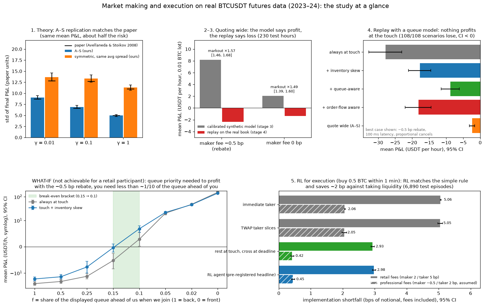
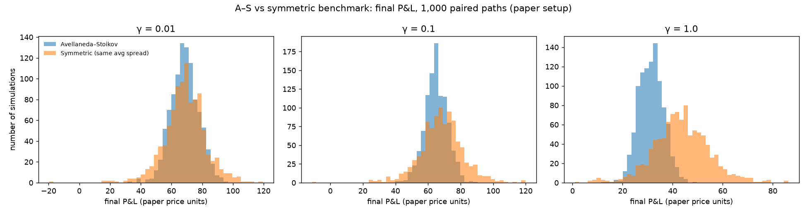
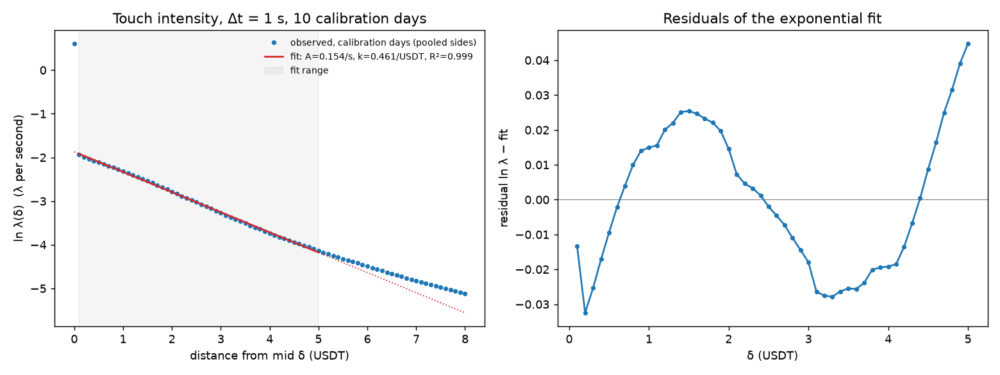
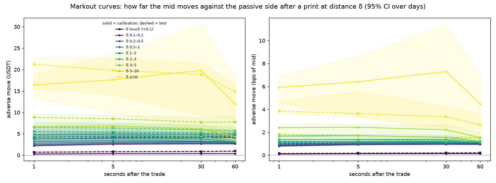
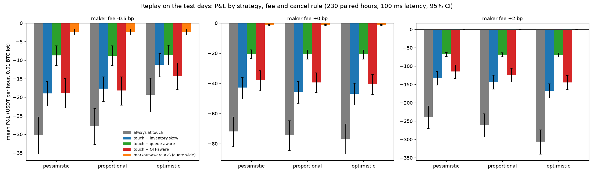
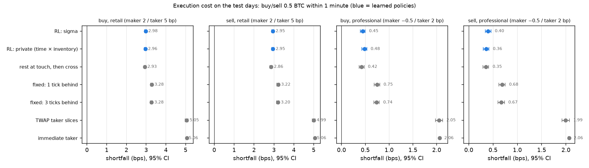
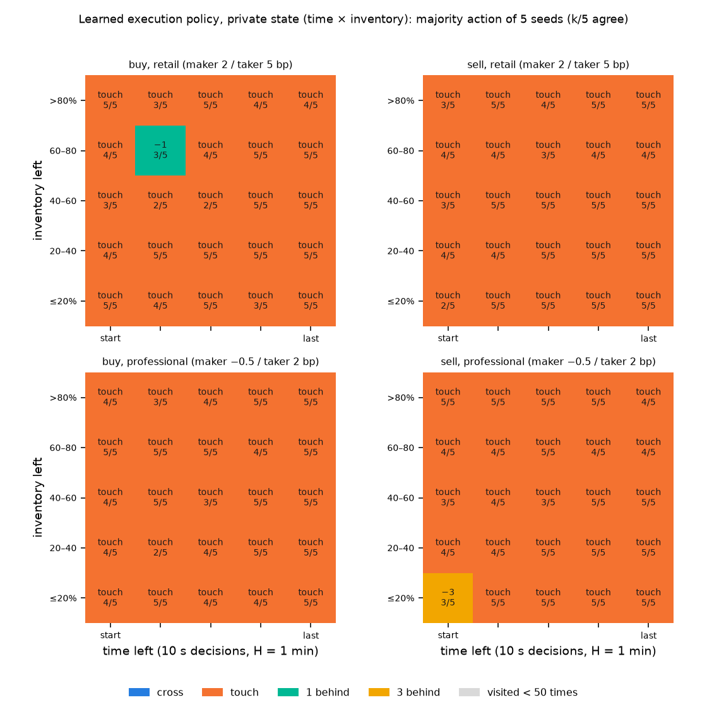
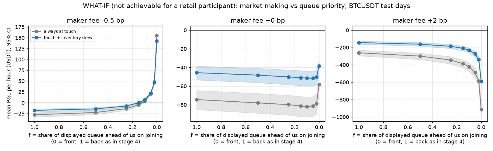

# Market making and execution on real BTCUSDT order-book data

A research project on two of the most basic jobs in electronic trading: **quoting both sides of the book**
(market making) and **getting a trade done cheaply** (optimal execution). It starts from the textbook
Avellaneda–Stoikov model, calibrates it to Binance BTCUSDT perpetual-futures data, measures how much
**adverse selection** (trading against better-informed flow) costs a market maker, then replays strategies on the
**recorded order book with a queue-position model**. Finally it trains a reinforcement-learning agent for
execution. Every result is reported over many paired hours or episodes, with 95% bootstrap confidence intervals.
Fitted parameters and learned policies are always tested on later, unseen days, and the main tests were
pre-registered before the test data was scored.


*The whole story in five panels, all built from cached results (`scripts/make_summary_figure.py`).*

## Key findings

- **The theory replicates.** Our Avellaneda–Stoikov (A–S) simulation matches the paper's table: at γ = 0.1, mean / std
  of profit 64.9 / 6.9 vs the paper's 65.0 / 6.6. Against a symmetric quote with the same average spread, A–S cuts
  the P&L standard deviation by 6.4 [5.6, 7.3] (about half) for a similar or slightly lower mean (1,000 paired paths per γ).
- **Adverse selection eats most of the spread, and the synthetic model understated it.** In the calibrated simulator
  (stage 3), informed flow took **87% [84, 89]** of A–S's profit at a 0 bp fee. Replaying the same strategy on the
  real book (stage 4) showed the markout of our fills is **1.49× [1.39, 1.60]** what the simulator assumed. A
  predicted +2.0 USDT/h became **−1.34 [−1.76, −0.89] USDT/h** on the same 230 test hours.
- **Nothing profits at the touch for a participant at the back of the queue.** All **108 of 108** scenarios lose
  money, with every 95% CI below zero: 4 touch strategies × 3 cancel rules × 3 latencies (0/100/300 ms) × 3 maker fees
  (−0.5/0/+2 bp). The best case is −5.6 [−7.7, −3.7] USDT/h.
- **Sweep fills are the problem, not queue fills.** 58% of our touch volume is filled by sweeps through our price.
  Within 60 s the price moves **4.94 [4.62, 5.24] USDT/BTC** (1.1 bp) against those fills, against
  **1.46 [1.28, 1.64]** (0.35 bp) for fills from the queue. A 0.5 bp rebate (~2 USDT/BTC) would pay for queue fills
  but never for sweeps.
- **What-if: queue priority.** With the −0.5 bp rebate, always-at-touch breaks even between joining with 15% of the
  displayed queue ahead of us (**−5.2 [−8.4, −2.5] USDT/h**) and 10% (**+2.9 [0.2, 5.5]**). You need less than about
  a tenth of the queue ahead of you **and** the rebate. At 0 bp or the retail +2 bp, it loses at every queue position.
- **RL for execution matches the best simple rule and saves ~2 bp against taking liquidity.** A tabular Q-learner that
  buys or sells 0.5 BTC within 1 minute costs **1.6–2.1 bp less** than crossing the spread immediately (buy, retail:
  −2.09 [−2.14, −2.03] bp). It rediscovers "rest at the touch, cross the remainder at the deadline", is
  0.02–0.09 bp *worse* than that rule, and market signals (order flow, queue size, volatility) add nothing out of sample.

## The story in four steps

**1. Theory: Avellaneda–Stoikov (stage 1).** The mid-price is Brownian motion, and fills arrive at rate
λ(δ) = A·e^(−kδ) at distance δ from the mid. The optimal maker quotes around a *reservation price*
r = S − q·γ·σ²·(T − t), which shifts down when it is long and up when it is short, with total spread
γσ²(T − t) + (2/γ)·ln(1 + γ/k). We reproduce the paper's three tables.


*Final P&L of A–S vs a symmetric quote with the same average spread, 1,000 paired paths per γ: similar means, A–S much narrower.*

**2. Calibration to BTCUSDT (stage 2).** We fit σ, A and k from Binance USD-M futures best bid/ask and trades on
10 calibration days (May–Oct 2023) and test them on 10 later days (Oct 2023 – Mar 2024). The exponential intensity
fits well (R² = 0.999 beyond the touch), but fixed parameters fail out of sample: BTC more than doubled in price and
the intensity rose with volatility. A model that conditions on trailing volatility passes the pre-registered test
(stage 3). Even at the calibrated parameters, A–S's optimal spread is 33–165× the real 1-tick spread. The model has
no competitors, so it prices like a monopolist.


*Fill intensity λ(δ) on the calibration days, with the exponential fit (left) and its residuals (right).*

**3. Realistic fills and adverse selection (stage 3).** After a trade, the mid moves against the passive side: about
1 bp within 60 s for prints beyond the touch, stable from calibration to test days. Order-flow imbalance predicts the
next 5 s move only weakly out of sample (R² 0.26%, hit rate 56%). In simulation, pricing the average markout like a
fee helps a little, and the flow signal adds nothing measurable. *These synthetic P&L numbers are superseded by step 4.*


*Markout curves: how far the mid moves against the passive side after a trade at distance δ from the mid (95% CI over days).*

**4. Replay with a queue model (stage 4).** We place virtual 0.01 BTC orders into the recorded book, 100 ms at a
time. An order joins the back of the queue. Trades at our price eat the queue ahead of us first, and a trade through
our price fills us. The fill *volume* the simulator predicted was right (ratio 0.98–1.06), but the adverse selection
was 1.5× larger, because our fills are selected by sweeps. No touch strategy makes money.


*Replay on the 230 test hours: mean P&L per hour by strategy, maker fee and cancel rule (100 ms latency, 95% CI). Every bar is below zero.*

**5. RL for execution (stage 5).** The replay becomes an execution environment, following Nevmyvaka, Feng & Kearns
(2006): buy or sell 0.5 BTC within 1 minute, deciding every 10 s whether to cross, rest at the touch, or rest 1 or
3 ticks behind. Our addition: an order keeps its queue place unless the action asks for a new price. Tabular
Q-learning learns the same policy as the simple rule.


*Implementation shortfall on the test days (6,890 paired episodes per side, 95% CI). Blue = learned policies; "rest at touch, then cross" is the best baseline.*


*The learned policy over time left × inventory left: "touch" in 98 of 100 cells, never "cross" early (majority of 5 training seeds).*

**Why 1 minute?** At 5 minutes, resting at the touch filled the whole order passively in 100% of training episodes,
so there was nothing left to learn. H = 2 and 5 minutes are reported as sensitivity checks with the same conclusion:
the all-variables agent costs 0.09–0.18 bp more than rest-at-touch (`results/stage5/execution_cost.md`).

### What-if: how much queue priority does a market maker need? (stage 5, Part B)

**This is a what-if, not something a new retail participant can do.** We rerun the touch strategies with only a
fraction f of the displayed queue ahead of us when we join (f = 1 is the realistic back of the queue, f = 0 the front).


*Mean P&L per hour against queue priority f, by maker fee (test days, 230 paired hours, 95% CI).*

With the −0.5 bp rebate, the break-even lies between f = 0.15 (still losing) and f = 0.1 (profitable). More priority
turns sweep fills into queue fills (sweeps are 61% of volume at f = 1 and 12% at f = 0), and queue fills are benign.
Without the rebate, quoting loses even from the front of the queue. A small RL market maker trained at f = 0.1 lost
−12.0 [−13.8, −10.3] USDT/h, and both hand-written rules beat it (`results/stage5/mm_whatif.md`).

## Method

- **Data.** Binance USD-M BTCUSDT perpetual futures, from the free public archive (data.binance.vision): `bookTicker`
  (every best bid/ask change) and `aggTrades`, SHA-256 verified. The days are 20 days chosen by a fixed volatility-tercile
  rule from the 320 days with both files (2023-05-16 → 2024-03-30). The data is reduced to 1 s snapshots (stages 2–3)
  and to 100 ms snapshots with sizes plus every trade (stages 4–5) ([DECISIONS: data](DECISIONS.md#data-and-day-selection)).
- **Splits.** Calibration days 2023-05-30 → 2023-10-10, test days 2023-10-25 → 2024-03-04, strictly later. In stage 5
  the first 8 calibration days train the agents, the last 2 choose the hyperparameters, and the 10 test days are
  evaluated once.
- **Queue model** (`src/mms/replay/queue.py`). Our order joins behind the displayed size. Volume traded at our price
  consumes the queue ahead first, and a trade through our price or the book crossing onto it fills us. Size decreases
  that trades do not explain are cancellations, split by three rules that bracket the truth: **pessimistic** (all
  behind us), **proportional**, **optimistic** (all ahead of us). Under every rule the queue ahead can never exceed the
  smallest size the level showed.
- **Latency** 100 ms for orders and cancels (0 and 300 ms as sensitivity checks). Orders are post-only, and our
  orders do not change anyone else's behaviour.
- **Fees.** Binance's regular tier is maker 2 bp / taker 5 bp (Binance fee FAQ, checked 2026-11-26). The
  "professional" tier is maker −0.5 bp / taker 2 bp, **an assumption**: no official tier table could be retrieved
  (see Limitations). Maker fees of 0, 1 and 2 bp and a −0.5 bp rebate are run everywhere, and the 0.1 USDT tick is
  respected.
- **Pre-registration.** Each decision rule was committed before the test data was scored: the choice of fill-intensity
  model ([stage 3](DECISIONS.md#step-1-pre-registration-choice-of-the-fill-intensity-model-written-and-committed-before-any-test-day-score-is-computed)),
  the strategy thresholds ([stage 4](DECISIONS.md#step-3-thresholds-rule-fixed-before-any-test-day-run)), the
  headline RL agent and comparison ([stage 5](DECISIONS.md#part-a-state-learning-episodes)), and the rule for training
  a what-if market maker ([Part B](DECISIONS.md#part-b-queue-priority-what-if-scriptsrun_stage5_queuepy)).
- **Statistics.** Strategies run on the same seeds, hours or episodes (paired). Percentile bootstrap 95% CIs
  resample hours (stage 4), episodes (stage 5) or simulated paths (stages 1–3). A day-block bootstrap is reported
  alongside, because hours within a day are correlated.

## Limitations

- **The replay assumes our orders change nobody's behaviour.** This is reasonable for 0.01 BTC, and less so for the
  0.5 BTC deadline clean-up in execution.
- **100 ms snapshots, top of book only.** Queues behind the touch are unseen and assumed to be ahead of us. The order
  of events within 100 ms is unknown, so trades are applied first.
- **2023–24 data, one instrument, 20 days.** The test period spans 10 days (230 hours) in a rising market. Nothing
  here has been checked on other coins, venues or years.
- **The queue cancel rules are assumptions.** Three rules bracket them, and no conclusion changes between them.
- **The synthetic results (stage 3) are superseded by the replay.** They overstated profitability by about 3–10 USDT/h
  because they underestimated the adverse selection on our own fills.
- **The professional fee tier is an assumption.** I could not retrieve Binance's official USD-M VIP table or the
  liquidity-provider tier list. Public announcements found by search (2022–2025) mention liquidity-provider maker rebates of −0.1 to −0.5 bp on
  USDT-margined pairs, so −0.5 bp is the best rebate tier, not a typical one.
- **RL hyperparameters sit at the edge of the episode grid** (160,000 episodes). Validation cost was still falling
  slowly, so more training might close part of the gap to rest-at-touch, but nothing suggests it would beat it.

## What I'd do next

- **Full-depth data** (Binance `depth` / L2 diff streams) to see queues behind the touch, and to test the cancel
  rules against real queue depletion instead of bracketing them.
- **Model the market's reaction to our orders** (the impact of the 0.5 BTC clean-up) and run the execution study at
  larger sizes, where timing should matter more than at 0.5 BTC.
- **A market maker that only quotes when it can expect queue priority**, e.g. joining a newly formed level. This
  turns the what-if into a strategy that can be tested.

## How to reproduce

Requirements: Windows or Linux, Python 3.13, ~23 GB RAM for the parallel steps, and ~2 GB free disk (peak
during downloads; ~1 GB kept under `data/`). The raw market data is **not** in the repo: the scripts download it
from data.binance.vision, verify the checksums and delete the raw zips after reducing them.

```
python -m venv .venv
.venv\Scripts\python -m pip install -r requirements.txt
.venv\Scripts\python -m pip install -e . --no-deps
.venv\Scripts\python -m pytest -q                                  # 160 tests, ~15 s

.venv\Scripts\streamlit run app\demo.py                            # the demo (below)
.venv\Scripts\python scripts\make_summary_figure.py                # results/summary.png from cached CSVs
```

| step | commands (`.venv\Scripts\python scripts\...`) | approx. time (from the run logs, 6 workers) |
|---|---|---|
| 1 replication | `run_replication.py` | 15 s |
| 2 data + calibration | `build_dataset.py`, `run_calibration.py`, `run_stage2_sim.py` | 30 min download + 10 min |
| 3 adverse selection | `build_stage3_windows.py`, `run_stage3_step0.py`, `run_stage3_model_choice.py`, `run_stage3_flow.py`, `run_stage3_sim.py` | under 30 min |
| 4 replay | `build_stage4_dataset.py` (re-downloads 20 days, ~25 min), `run_stage4_replay.py tune\|test\|report --workers 4`, `run_stage4_validation.py --workers 4` | ~4 h |
| 5 RL | `run_stage5_exec.py cuts\|fixed\|tune\|train\|test\|report --workers 4`, `run_stage5_queue.py run\|report --workers 4`, `run_stage5_mm.py gamma\|train\|test\|report --workers 4` | ~6 h |

**Workers.** Each replay or training worker holds up to 8–10 days in memory (1.5–2 GB). On a 23 GB machine use at
most **4–6 workers**. The stage 5 pool drops to 4 automatically if free memory falls below 4 GB. Everything is
seeded, and rerunning a cached step reads its cached result. Times are from a 16-thread laptop.

### Demo

```
.venv\Scripts\streamlit run app\demo.py
```

The demo has three tabs. (1) An **A–S explainer** with sliders for γ, σ, k and q, plus one synthetic path.
(2) **Replay a market-making hour** on any test day: the book, our quotes, the queue ahead, fills marked as queue or
sweep, and cumulative P&L, including the queue-priority what-if. (3) The **learned execution policy** heatmap and one
replayed execution episode, RL vs the baselines. Tabs 2–3 need the processed data under `data/`. Without it, they
explain how to rebuild it instead of failing. Replayed numbers are cross-checked against the cached stage 4/5
results on screen.

## How this was built

Code written with Claude Code (an AI coding assistant) under my direction. Research design choices, pre-registered tests and every judgement call are logged in DECISIONS.md.

Per-stage reports: [stage 3](results/stage3/REPORT.md) (superseded), [stage 4](results/stage4/REPORT.md),
[stage 5](results/stage5/REPORT.md). Interview notes: [docs/INTERVIEW_NOTES.md](docs/INTERVIEW_NOTES.md).

## References

- M. Avellaneda and S. Stoikov (2008). High-frequency trading in a limit order book. *Quantitative Finance* 8(3), 217–224.
- T. Spooner, J. Fearnley, R. Savani and A. Koukorinis (2018). Market making via reinforcement learning. *AAMAS 2018*.
- Y. Nevmyvaka, Y. Feng and M. Kearns (2006). Reinforcement learning for optimized trade execution. *ICML 2006*.
- Binance public market data: https://data.binance.vision (USD-M futures `bookTicker`, `aggTrades`, 1-minute klines; accessed November 2026).
- Binance Futures fee structure FAQ: https://www.binance.com/en/support/faq/360033544231 (regular tier, checked 2026-11-26).
- B. Efron and R. Tibshirani (1993). *An Introduction to the Bootstrap*. Chapman & Hall (percentile bootstrap CIs).

<details>
<summary><b>All charts, with one-line captions</b></summary>

| chart | caption |
|---|---|
| [summary.png](results/summary.png) | The study at a glance: replication, synthetic vs replay, touch strategies, queue what-if, execution. |
| [stage1/sample_path.png](results/stage1/sample_path.png) | One A–S path (γ = 0.1): mid, bid/ask and inventory; quotes lean against the inventory. |
| [stage1/pnl_distributions.png](results/stage1/pnl_distributions.png) | Final P&L, A–S vs symmetric with the same average spread, per γ (1,000 paired paths). |
| [stage1/inventory_distributions.png](results/stage1/inventory_distributions.png) | Final inventory, A–S vs symmetric: A–S keeps inventory near zero. |
| [stage2/fit_calibration.png](results/stage2/fit_calibration.png) | ln λ(δ) on the calibration days with the exponential fit, and its residuals. |
| [stage2/oos_fit.png](results/stage2/oos_fit.png) | Out of sample: predicted vs observed λ(δ) on the 10 test days (fixed parameters fail). |
| [stage2/parameter_stability.png](results/stage2/parameter_stability.png) | σ, A and k by day; k falls with σ, which motivates the σ-conditional model. |
| [stage2/window_sensitivity.png](results/stage2/window_sensitivity.png) | λ(δ) estimated with 1, 2 and 5 s windows: the estimates depend on the window. |
| [stage2/pnl_by_fee.png](results/stage2/pnl_by_fee.png) | Simulated 1-hour P&L by fee scenario (medium volatility): fees decide profitability. |
| [stage2/pnl_by_fee_all_regimes.png](results/stage2/pnl_by_fee_all_regimes.png) | The same by volatility regime. |
| [stage3/model_choice.png](results/stage3/model_choice.png) | Pre-registered out-of-sample score of the two candidate fill models, per test day. |
| [stage3/markout_curves.png](results/stage3/markout_curves.png) | Markout after trades at distance δ: the mid moves ~1 bp against the passive side within 60 s. |
| [stage3/ofi_predictive_power.png](results/stage3/ofi_predictive_power.png) | Order-flow imbalance → next mid move: R², hit rate and slope by horizon, in and out of sample. |
| [stage3/pnl_by_strategy_fee.png](results/stage3/pnl_by_strategy_fee.png) | Synthetic P&L by strategy and maker fee (superseded by the replay). |
| [stage3/break_even_fee.png](results/stage3/break_even_fee.png) | Synthetic break-even maker fee by strategy and regime (superseded). |
| [stage3/predictive_power_sweep.png](results/stage3/predictive_power_sweep.png) | Value of the flow signal as its true predictive power varies (0–2× measured): ~nothing. |
| [stage3/sample_path_flow.png](results/stage3/sample_path_flow.png) | One synthetic path with informed flow: quotes lean ahead of the order flow. |
| [stage4/validation_replay_vs_synthetic.png](results/stage4/validation_replay_vs_synthetic.png) | Replay vs synthetic on the same test hours: fills match, markouts are 1.5× larger. |
| [stage4/pnl_by_strategy_fee_rule.png](results/stage4/pnl_by_strategy_fee_rule.png) | Replay P&L per hour by strategy, fee and cancel rule: all negative. |
| [stage4/markouts_touch_vs_wide.png](results/stage4/markouts_touch_vs_wide.png) | 60 s markout of our fills: queue fills vs sweeps, and by distance from the mid. |
| [stage4/latency_sensitivity.png](results/stage4/latency_sensitivity.png) | P&L against latency (0/100/300 ms): lower latency means more fills and larger losses. |
| [stage4/sample_hour_queue.png](results/stage4/sample_hour_queue.png) | Three minutes of queue-aware quoting: quotes, queue ahead vs displayed size, fills, inventory. |
| [stage5/execution_cost.png](results/stage5/execution_cost.png) | Execution shortfall on the test days: RL ≈ rest-at-touch ≪ taking liquidity. |
| [stage5/policy_heatmap_private.png](results/stage5/policy_heatmap_private.png) | Learned policy over time left × inventory left: rest at the touch almost everywhere. |
| [stage5/policy_heatmap_market_retail.png](results/stage5/policy_heatmap_market_retail.png) | How each market variable shifts the policy (retail fees): a few inconsistent cells. |
| [stage5/policy_heatmap_market_pro.png](results/stage5/policy_heatmap_market_pro.png) | The same with professional fees. |
| [stage5/state_value.png](results/stage5/state_value.png) | Value of each state variable out of sample: none reduces cost. |
| [stage5/learning_curves.png](results/stage5/learning_curves.png) | Learning curves on validation and training days (5 seeds): approaching, not reaching, rest-at-touch. |
| [stage5/break_even_queue.png](results/stage5/break_even_queue.png) | WHAT-IF: market-making P&L against queue priority f, by fee. |

</details>

## Licence

MIT, see [LICENSE](LICENSE).
